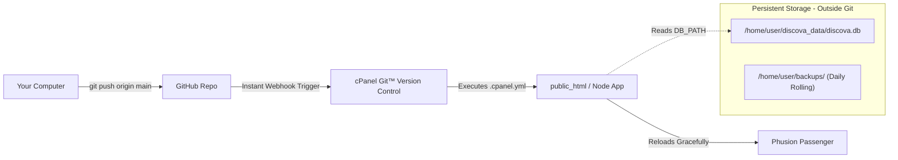

# 🚀 cPanel Automated Deployment & Database Persistence Guide

This guide walks you through setting up automated GitHub deployments on **cPanel** and ensuring that future updates **never delete or overwrite your live database**.

---

## 🏗️ How the Architecture Works



- **Zero-loss database**: The database file `discova.db` is stored outside the website repository in `/home/USERNAME/discova_data/`. It is never tracked in Git, so git pulls can never overwrite or delete it.
- **Zero-downtime reloads**: Every time you push code to GitHub, cPanel automatically pulls the changes, runs `npm install`, and updates `tmp/restart.txt` to reload the server instantly.

---

## Step 1: Push Your Code to GitHub

Run these commands in your local project terminal (on your Mac):

```bash
# 1. Initialize git
git init

# 2. Add all files (the new .gitignore automatically protects discova.db)
git add .

# 3. Create your first commit
git commit -m "feat: complete platform backend, admin suite, and cpanel automation"

# 4. Set branch to main
git branch -M main

# 5. Link to your GitHub repository (replace with your repo URL)
git remote add origin https://github.com/YOUR_USERNAME/YOUR_REPOSITORY.git

# 6. Push code to GitHub
git push -u origin main
```

---

## Step 2: Set Up the Node.js App in cPanel (60 Seconds)

1. Log into your **cPanel Dashboard**.
2. Under the **Software** section, click **Setup Node.js App**.
3. Click the blue **Create Application** button.
4. Fill in these settings:
   - **Node.js version**: Select `20.x` or `22.x` (or the highest version available).
   - **Application mode**: `Production`
   - **Application root**: `public_html` *(or the folder where your site lives)*.
   - **Application startup file**: `server/server.js`
5. Scroll down to **Environment variables** and click **Add Variable**:
   - **Name**: `DB_PATH`
   - **Value**: `/home/YOUR_CPANEL_USERNAME/discova_data/discova.db`
     *(Replace `YOUR_CPANEL_USERNAME` with your actual cPanel username visible in the top right of your cPanel screen).*
   - **Name**: `NODE_ENV`
   - **Value**: `production`
6. Click **Create** at the top right.

---

## Step 3: Connect GitHub to cPanel (Git™ Version Control)

1. In your cPanel dashboard, go to the **Files** section and click **Git™ Version Control**.
2. Click **Create**:
   - **Clone a Repository**: Toggle to **ON**.
   - **Clone URL**: Paste your GitHub clone URL (e.g. `https://github.com/YOUR_USERNAME/YOUR_REPO.git` or SSH URL).
   - **Repository Path**: `repositories/discova` *(cPanel fills this automatically)*.
   - **Repository Name**: `discova`
3. Click **Create**.
4. Once cloned, click **Manage** next to your new repository.
5. In the **Deploy** or **Webhook** tab, copy the **Webhook URL** provided by cPanel.

---

## Step 4: Enable Instant Auto-Deploy on GitHub (30 Seconds)

1. Open your repository on **GitHub.com**.
2. Go to **Settings** → **Webhooks** → click **Add webhook**.
3. **Payload URL**: Paste the cPanel Webhook URL you copied in Step 3.
4. **Content type**: Select `application/json`.
5. **Which events**: Select **"Just the push event"**.
6. Click **Add webhook**.

🎉 **You're Done!** Now, whenever you push commits to GitHub, GitHub pings cPanel, cPanel pulls the commits, installs dependencies, and restarts the app with zero downtime!

---

## Step 5: (Optional) Set Up Automated Daily Database Backups

To keep rolling 30-day backups of your SQLite database:

1. In cPanel, go to the **Advanced** section → **Cron Jobs**.
2. Under **Add New Cron Job**, select **Once Per Day (0 2 * * *)** (or 2:00 AM).
3. In the **Command** box, paste:
   ```bash
   /bin/bash /home/YOUR_CPANEL_USERNAME/public_html/scripts/backup-db.sh
   ```
   *(Replace `YOUR_CPANEL_USERNAME` with your actual cPanel username).*
4. Click **Add New Cron Job**.

---

## 💡 Helpful Tips & Troubleshooting

### How to Manually Reload the Server
If you ever edit a file directly in cPanel File Manager and want to reload the Node app without logging into SSH:
1. Go to **File Manager** → open your application root (e.g. `public_html`).
2. Open the `tmp/` folder.
3. Right-click `restart.txt` and click **Edit** (or touch it). Any timestamp change on `tmp/restart.txt` causes cPanel to gracefully reload Node.js!

### How to Seed the Database the First Time
When your app boots for the very first time on cPanel, `server/db.js` creates all tables automatically. If you want to seed the initial curated startups:
1. In cPanel **Setup Node.js App**, click the icon to enter the virtual environment, or run:
   ```bash
   node server/seed.js
   ```
   *(Only run this once during initial setup; future deployments will never re-run it).*

### Viewing Live Logs
In cPanel File Manager, you will find `stderr.log` and `stdout.log` inside your application root folder. If an error occurs, you can view the exact trace there.
